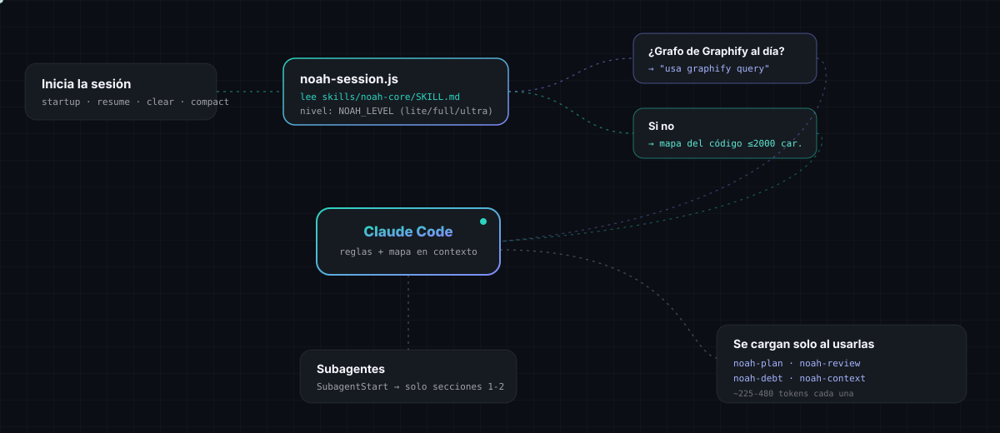
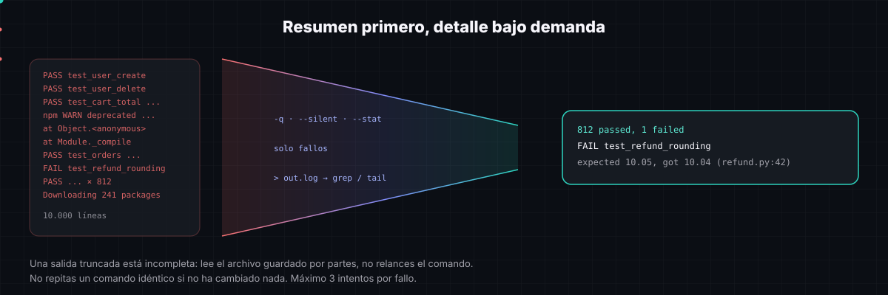
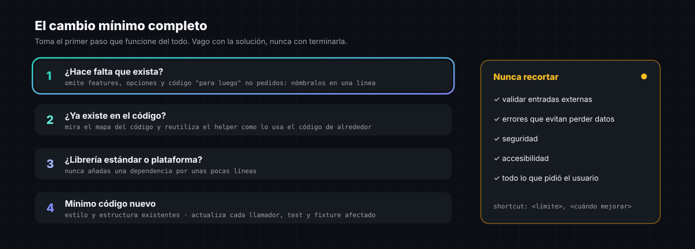
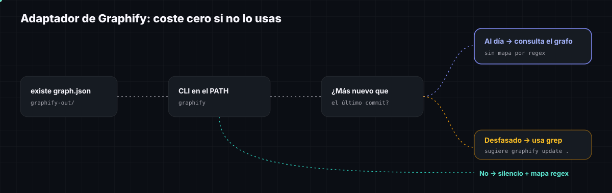
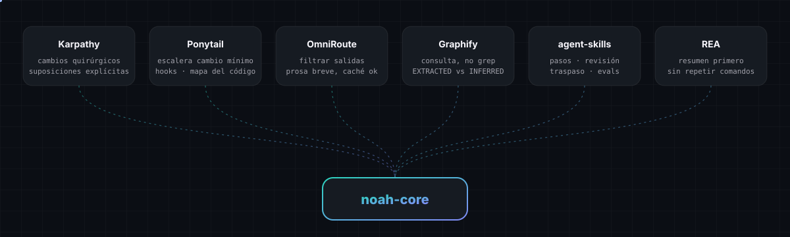

<div align="center">



[English](./README.md) · **Español**

### 🌐 [Web, guía y constructor de prompts → smith-develop.github.io/Noah-core](https://smith-develop.github.io/Noah-core/)

</div>

---

Noah Core es un plugin de Claude Code que abarata cada sesión **sin empeorar el trabajo**. Cuatro reglas, un núcleo de ~1,2k tokens, dos hooks y cuatro sub-skills que se cargan solo cuando hacen falta:

| Pilar | Qué hace Claude distinto |
|---|---|
| **Contexto mínimo** | Busca con grep antes de leer, lee rangos de líneas, no relee lo que acaba de escribir, lanza en paralelo las llamadas independientes y manda las búsquedas amplias a un subagente. |
| **Resumen primero** | Primero flags silenciosos y solo fallos; las salidas grandes van a un archivo y se leen con `grep`/`tail`; nada de repetir comandos idénticos; máximo 3 intentos por fallo. |
| **Cambio mínimo completo** | Reutilizar → stdlib → código mínimo. Actualiza cada llamador y test que toca. Nunca recorta validación, seguridad, manejo de errores ni accesibilidad. |
| **Respuestas cortas y honestas** | Sin narrar pasos ni repetir código. Separa lo verificado de lo supuesto. Termina diciendo qué no comprobó. |

## Instalación

> Guía paso a paso en español e inglés y constructor de prompts interactivo: **[https://smith-develop.github.io/Noah-core/](https://smith-develop.github.io/Noah-core/)**

**Plugin de Claude Code (recomendado: incluye los hooks)**

```
/plugin marketplace add Smith-Develop/Noah-core
/plugin install noah-core@noah-core
```

Reinicia Claude Code. Las reglas se cargan solas en cada sesión.

O en un solo comando (Claude Code v2.1.275 o superior): `/plugin install noah-core --marketplace Smith-Develop/Noah-core`

**Solo la skill (sin hooks)**: copia `skills/noah-core` (y las otras carpetas `skills/noah-*` que quieras) en `~/.claude/skills/`. El núcleo se cargará cuando Claude lo considere relevante o cuando escribas `/noah-core`.

## Cómo se carga



- **`SessionStart`** inyecta las reglas del núcleo y, además, un **mapa del código** compacto (funciones y clases de primer nivel por carpeta, ≤2.000 caracteres, sin modelo ni dependencias) o la nota de Graphify.
- **`SubagentStart`** inyecta en cada subagente solo las reglas de contexto y salida; sin esto, los subagentes arrancan sin reglas.
- Las reglas viven en un único sitio: `skills/noah-core/SKILL.md`. Los hooks lo leen de ahí, así que la skill y el contexto inyectado nunca se desincronizan.

## Resumen primero, detalle bajo demanda



En una sesión de programación, la mayor parte del contexto es salida de herramientas, no el código que escribe Claude. Noah pide primero la versión corta y solo entra al detalle donde queda una pregunta concreta.

## El cambio mínimo completo



## Comandos y niveles

| Comando | Qué hace | Coste al cargarse |
|---|---|---|
| `/noah-core [lite\|full\|ultra]` | Cambia el nivel en esta sesión | ~1,2k tokens |
| `/noah-plan [tarea] [auto]` | Preguntas → vista mínima → 3-7 pasos verificables → construir | ~450 tokens |
| `/noah-review [objetivo]` | Bugs, riesgos, escala, riesgo sin test, código sobrante; lee los llamadores, no solo el diff | ~480 tokens |
| `/noah-debt` | Registro de todos los comentarios `shortcut:` | ~225 tokens |
| `/noah-context [save\|resume]` | Archivo de traspaso en `.noah/handoff.md` y cuándo usar `/clear` o `/compact` | ~380 tokens |

| Nivel | Comportamiento |
|---|---|
| `lite` | Solo reglas de contexto, salida, preguntas y respuestas. Construye lo pedido y ofrece la opción más pequeña. |
| `full` | Todo. Por defecto. |
| `ultra` | Todo, y además cuestiona cualquier parte de la petición que la necesidad real no justifique. |

**Variables de entorno** (en `~/.claude/settings.json`, dentro de `"env"`):

| Variable | Por defecto | Efecto |
|---|---|---|
| `NOAH_LEVEL` | `full` | `lite`, `full`, `ultra`, u `off` para desactivar los hooks |
| `NOAH_MAP` | activado | `0` omite el mapa del código |
| `NOAH_MAP_CHARS` | `2000` | Presupuesto del mapa del código |
| `NOAH_SUBAGENTS` | activado | `0` deja de inyectar reglas en los subagentes |

## Adaptador de Graphify



Si ya usas [Graphify](https://github.com/Graphify-Labs/graphify), Noah lo aprovecha. Cuando existe `graphify-out/graph.json` **y** el comando `graphify` está en tu PATH, se le indica a Claude que responda las preguntas de arquitectura con `graphify query`, y el mapa por regex se omite. Si el grafo es más antiguo que tu último commit, Claude usa grep y sugiere `graphify update .`. Sin Graphify, Noah no lo menciona y no cuesta nada extra. Noah no instala Graphify ni incluye su skill.

## De dónde vienen las ideas



Noah es una implementación original: toma ideas de estos proyectos, no código.

| Proyecto | Idea | Licencia |
|---|---|---|
| [andrej-karpathy-skills](https://github.com/multica-ai/andrej-karpathy-skills) | Cambios quirúrgicos, hacer explícitas las suposiciones | MIT |
| [Ponytail](https://github.com/dietrichgebert/ponytail) | Escalera del cambio mínimo, lista de lo que nunca se recorta, hooks de sesión, mapa del código, registro `shortcut:` | MIT |
| [OmniRoute](https://github.com/diegosouzapw/OmniRoute) | Filtrar la salida de herramientas en origen; no romper el prompt caching | MIT |
| [Graphify](https://github.com/Graphify-Labs/graphify) | Consultar un grafo en lugar de hacer grep; EXTRACTED frente a INFERRED | Apache-2.0 |
| [agent-skills](https://github.com/addyosmani/agent-skills) | Planes en pasos verificables, revisión, traspaso, evals de skills | MIT |
| [REA](https://github.com/morluto/rea) | Resumen primero, sin repeticiones idénticas, salida truncada ≠ completa, observado / inferido / desconocido | MIT |

## Qué ejecuta Noah en tu equipo

Noah no envía nada a ningún sitio: ni llamadas de red, ni telemetría, ni dependencias que instalar.

| Hook | Cuándo | Qué hace |
|---|---|---|
| `hooks/noah-session.js` | Al iniciar o reanudar la sesión, tras `/clear` y `/compact` | Lee `skills/noah-core/SKILL.md`. Lista los archivos con `git ls-files` (o recorre la carpeta si no hay git), lee los archivos de código de hasta 200 KB con expresiones regulares para construir el mapa, y lee `git log -1` y la fecha de `graphify-out/graph.json` si existe. Devuelve el resultado como contexto de la sesión. |
| `hooks/noah-subagent.js` | Al arrancar cada subagente | Lee `SKILL.md` y devuelve las reglas de contexto y salida. |

Los dos hooks son scripts de Node.js legibles, en este repo y sin compilar. No escriben archivos. `/noah-context save` escribe `.noah/handoff.md` en tu proyecto, y solo cuando tú lo pides.

## Cómo medirlo

Noah **todavía no publica cifras de ahorro**. Saldrán de comparativas A/B sobre tus propias tareas, no de estimaciones. En [`evals/`](./evals/README.md) tienes cómo comparar las mismas tareas con y sin Noah (tokens, coste, turnos y si pasan o fallan).

## Desarrollo

```bash
npm test           # tests de hooks y mapa (node:test, sin dependencias)
npm run validate   # frontmatter + presupuestos de tokens (núcleo ≤ 6.500 caracteres)
npm run diagrams   # regenera docs/diagrams/es/ tras editar un SVG en inglés
claude --plugin-dir .   # probar el plugin en local
```

## Licencia

[MIT](./LICENSE) © Smith-Develop
