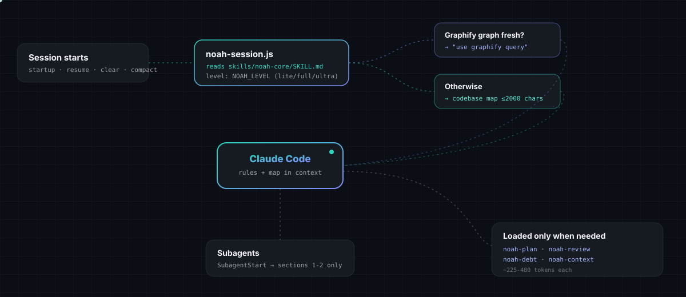
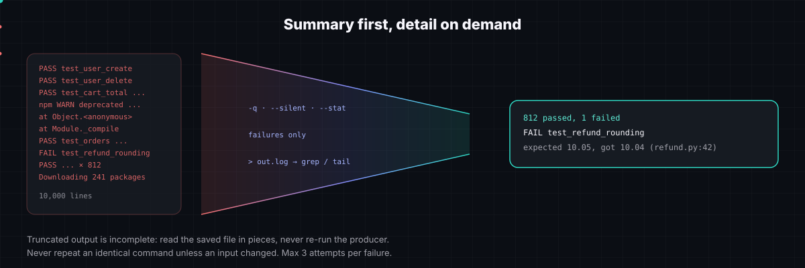
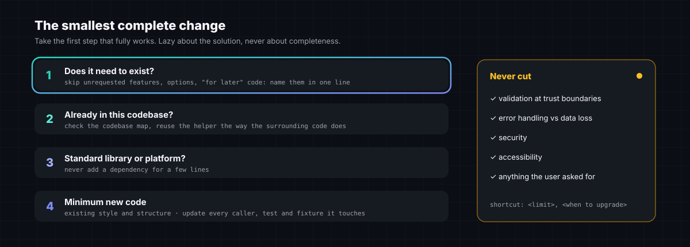
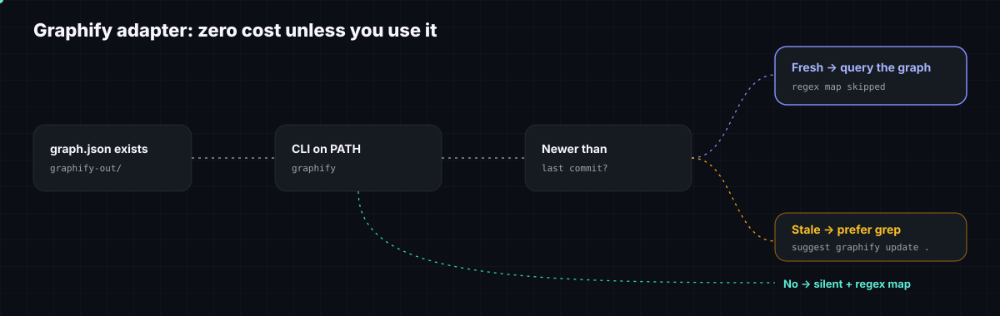
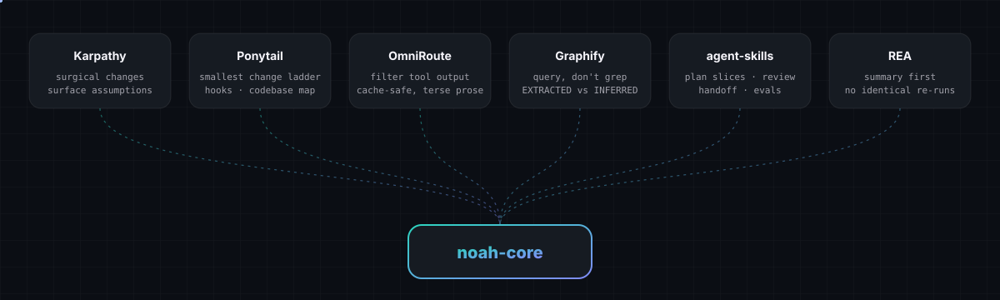

<div align="center">



**English** · [Español](./README.es.md) · [Website & prompt builder](https://smith-develop.github.io/Noah-core/)

</div>

---

Noah Core is a Claude Code plugin that makes every session cheaper **without making the work worse**. Four rules, a ~1.2k-token core, two hooks, and four on-demand sub-skills:

| Pillar | What Claude does differently |
|---|---|
| **Lean context** | Greps before reading, reads line ranges, never re-reads what it just wrote, runs independent calls in parallel, sends broad searches to a subagent. |
| **Summary-first output** | Quiet flags and failures-only first; big output goes to a file and is read with `grep`/`tail`; no identical re-runs; max 3 attempts per failure. |
| **Smallest complete change** | Reuse → stdlib → minimal code. Updates every caller and test it touches. Never cuts validation, security, error handling or accessibility. |
| **Short, honest replies** | No narration, no reprinted code. Separates verified from assumed. Ends with what it did not check. |

## Install

**Claude Code plugin (recommended: includes the hooks)**

```
/plugin marketplace add Smith-Develop/Noah-core
/plugin install noah-core@noah-core
```

Restart Claude Code. The rules load automatically in every session.

**Skill only (no hooks)**: copy `skills/noah-core` (and the other `skills/noah-*` folders you want) into `~/.claude/skills/`. The core then loads when Claude decides it is relevant, or when you type `/noah-core`.

## How it loads



- **`SessionStart`** injects the core rules plus either a compact **codebase map** (top-level functions and classes per folder, ≤2,000 chars, no model, no dependencies) or the Graphify note.
- **`SubagentStart`** injects only the context and output rules into each subagent, which would otherwise start without them.
- The ruleset has a single source: `skills/noah-core/SKILL.md`. The hooks read it, so the skill and the injected context never drift apart.

## Summary first, detail on demand



In a coding session, most of the context is tool output, not the code Claude writes. Noah asks for the short form first and drills down only where a concrete question remains.

## The smallest complete change



## Commands and levels

| Command | What it does | Cost when loaded |
|---|---|---|
| `/noah-core [lite\|full\|ultra]` | Switch level for this session | ~1.2k tokens |
| `/noah-plan [task] [auto]` | Questions → smallest overview → 3-7 verifiable slices → build | ~450 tokens |
| `/noah-review [target]` | Bug, risk, scale, untested risk, needless code; reads callers, not just the diff | ~480 tokens |
| `/noah-debt` | Ledger of every `shortcut:` comment | ~225 tokens |
| `/noah-context [save\|resume]` | Handoff file in `.noah/handoff.md`, plus when to `/clear` or `/compact` | ~380 tokens |

| Level | Behavior |
|---|---|
| `lite` | Context, output, asking and reply rules only. Builds what you asked and offers the smaller option. |
| `full` | Everything. Default. |
| `ultra` | Full, plus pushes back on any part of the request the need does not justify. |

**Environment variables** (set them in `~/.claude/settings.json` under `"env"`):

| Variable | Default | Effect |
|---|---|---|
| `NOAH_LEVEL` | `full` | `lite`, `full`, `ultra`, or `off` to disable the hooks |
| `NOAH_MAP` | on | `0` skips the codebase map |
| `NOAH_MAP_CHARS` | `2000` | Budget for the codebase map |
| `NOAH_SUBAGENTS` | on | `0` stops injecting rules into subagents |

## Graphify adapter



If you already use [Graphify](https://github.com/Graphify-Labs/graphify), Noah picks it up: when `graphify-out/graph.json` exists **and** the `graphify` CLI is on your PATH, Claude is told to answer architecture questions with `graphify query` and the regex map is skipped. If the graph is older than your last commit, Claude prefers grep and suggests `graphify update .`. Without Graphify, Noah says nothing about it and costs nothing extra. Noah does not install Graphify or ship its skill.

## Where the ideas come from



Noah is an original implementation. It borrows ideas, not code, from these projects:

| Project | Idea | License |
|---|---|---|
| [andrej-karpathy-skills](https://github.com/multica-ai/andrej-karpathy-skills) | Surgical changes, surfaced assumptions | MIT |
| [Ponytail](https://github.com/dietrichgebert/ponytail) | Smallest-change ladder, never-cut list, session hooks, codebase map, `shortcut:` ledger | MIT |
| [OmniRoute](https://github.com/diegosouzapw/OmniRoute) | Filter tool output at the source; don't break prompt caching | MIT |
| [Graphify](https://github.com/Graphify-Labs/graphify) | Query a graph instead of grepping; EXTRACTED vs INFERRED | Apache-2.0 |
| [agent-skills](https://github.com/addyosmani/agent-skills) | Plan in verifiable slices, review, handoff, skill evals | MIT |
| [REA](https://github.com/morluto/rea) | Summary first, no identical re-runs, truncated ≠ complete, observed vs inferred vs unknown | MIT |

## Measuring it

Noah publishes **no savings figures yet**. They will come from A/B runs on your own tasks, not from estimates. See [`evals/`](./evals/README.md) to compare the same tasks with and without Noah (tokens, cost, turns, pass/fail).

## Development

```bash
npm test           # hook and map tests (node:test, no dependencies)
npm run validate   # frontmatter + token budgets (core ≤ 6,500 chars)
claude --plugin-dir .   # try the plugin locally
```

## License

[MIT](./LICENSE) © Smith-Develop
